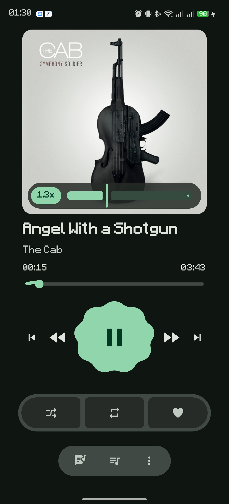

  
  <h1>Outify Nightcore Mod</h1>
  

    <strong>Spotify on Android with nightcore-style playback speed</strong> 
    A fork of <a href="https://github.com/iTomKo/Outify">Outify</a>, the open source Material 3 Spotify client built on <a href="https://github.com/librespot-org/librespot">librespot</a>
  

  
  
  

  

    <a href="https://github.com/danielwoww/Outify-Nightcore-Mod/releases/latest"><strong>Download the latest APK</strong></a>
    ·
    <a href="https://github.com/danielwoww/Outify-Nightcore-Mod/issues/new/choose">Report a problem</a>
    ·
    <a href="./docs/NIGHTCORE-MOD.md">Technical details</a>
  

  

## Features

- **Nightcore playback speed**: speeding up raises tempo *and* pitch together, like speeding up a record. Slowing down lowers the pitch the same way.
- **Speed slider on the album art**: always visible, from 0.5x to 3x in 0.05 steps. The speed changes live while you drag. Tap the label to reset to 1x.
- **Speed is remembered** across restarts, track changes and app updates.
- **Clean audio at high speed**: playback is resampled by Android's own audio pipeline, with no dropouts or clicks even at 3x.
- **Reliable playback**: song taps and play / next / previous / seek are never silently ignored because Spotify thinks another device is still active. The app also no longer gets killed while waiting for playback to start.

Everything else from Outify is included and kept up to date: search, playlists, albums, artists and your library, lyrics, queue and radio, Spotify Connect remote control, Jams, a media notification and a dynamic Material 3 theme.

## Install

1. Download the APK from the [latest release](https://github.com/danielwoww/Outify-Nightcore-Mod/releases/latest). `arm64-v8a` fits most phones; `universal` works everywhere.
2. If you have the official Outify app installed, uninstall it first. This fork is signed with its own key, so it can't update Outify in place.
3. Log in with your Spotify account.

Requires **Spotify Premium**.

Speed applies to music playing on your phone. When another device (PC, speaker) is playing, Outify acts as a remote for it. Pick Outify under *Playback devices* to play on your phone.

## Screenshots

  
  
  
  

## Building

See [docs/NIGHTCORE-MOD.md](./docs/NIGHTCORE-MOD.md) for build and release instructions, how each feature works, and how upstream updates are merged.

## Credits

- [iTomKo/Outify](https://github.com/iTomKo/Outify) by TomKo, the app this fork is built on. Please report problems with this mod [here](https://github.com/danielwoww/Outify-Nightcore-Mod/issues/new/choose), not to the Outify project.
- [librespot](https://github.com/librespot-org/librespot) for the Spotify streaming backend
- Outify's translators on [Weblate](https://translate.codeberg.org/engage/outify/)

## License and disclaimer

Licensed under [GPL-3.0](./LICENSE), like Outify. Not affiliated with Spotify, Google, librespot or the Outify project. Using this app **can** be against Spotify's Terms of Service. Use at your own risk.
