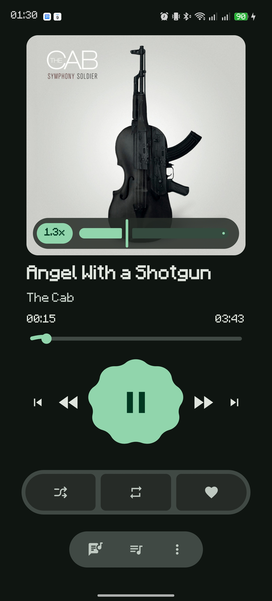

# Outify Nightcore Mod

A fork of [iTomKo/Outify](https://github.com/iTomKo/Outify) (currently based on **Outify
2.0.0**) that adds nightcore-style playback speed, plus a set of playback fixes.

<p align="center">
  
</p>

## Download

Get the latest APK from the
[Releases page](https://github.com/danielwoww/Outify-Nightcore-Mod/releases/latest):

| APK | For |
|---|---|
| `…-arm64-v8a.apk` | most phones |
| `…-armeabi-v7a.apk` | older 32-bit phones |
| `…-universal.apk` | either (larger download) |

`SHA256SUMS.txt` lists the checksums of the APKs.

**Installing:** release APKs are signed with this fork's own key (certificate SHA-256
`820b607080e4c077580b34505cc9ad6b9a28890b3b15d75a2655e5d7a70006e7`). Android won't let them
update the official Outify app or a self-built debug version, so uninstall that first. You
will have to log in again.

Like Outify, this mod requires **Spotify Premium**.

## Features

- **Nightcore playback speed:** changing the speed raises (or lowers) tempo *and* pitch
  together, like speeding up a record. Upstream Outify keeps the pitch the same.
- **Speed slider:** an always-visible 0.5x – 3x slider on the album art. It snaps to 0.05
  steps, the speed changes live while dragging, and tapping the speed label resets to 1x.
- **Speed is remembered** across app restarts and updates.
- **Outify is the default playback device:** tapping a song, or pressing play / next /
  previous / seek, plays on this phone, even if another Spotify device is still listed as
  active. Just opening the app does not take playback away from another device.
- **Playback stability fixes:** no more random stops, no ANR kill while waiting for
  playback, and no dropouts at high speeds. See below.

## Technical details

### Nightcore playback speed
Upstream Outify uses Media3's `SonicAudioProcessor`, which changes speed while keeping the
pitch (time-stretch). This mod removes Sonic and *resamples* instead.

`playback/AudioEngine.kt`:
- **Preferred path:** `AudioTrack.setPlaybackRate(sampleRate * speed)`. Android's own
  resampler does the work. It sounds good and costs no CPU or allocations.
- **Fallback:** some devices reject rates above ~2x their native output rate. In that case a
  software linear-interpolation resampler is used. It keeps its fractional position and the
  last frame between PCM chunks so there are no clicks at chunk boundaries, and it reuses
  its output buffer.
- The `AudioTrack` buffer is sized for the maximum speed. At N x the track drains N times
  faster, and a 1x-sized buffer underran at 3x.

`playback/Player.kt` reports `PlaybackParameters(speed, pitch = speed)` to media controllers.

### Speed slider
`ui/screens/player/PlaybackSpeedControl.kt` replaces upstream's preset buttons and
custom-speed sheet with the slider. `ui/screens/player/PlayerContent.kt` shows it on the
album art permanently, so it no longer needs a tap on the cover to appear.

### Speed is remembered
The speed is stored in DataStore (`playback_speed` in `SettingsRepository`). `Player`
restores it on startup without overwriting a speed the user already changed while it
loaded. It saves changes debounced, so dragging the slider writes once when it settles.
`PlaybackStateHolder.reset()` keeps the speed.

### Outify is the default playback device
librespot ignores every command except Activate/Transfer while another Spotify Connect
device (PC, speaker, web player) is the active device:

```
SpircCommand::... will be ignored while Not Active
```

Smart transfer deliberately doesn't take over on startup when another device is active,
so tapping a song used to do nothing until Outify was picked manually under *Playback
devices*. In `core/spirc/SpircWrapper.kt`:
- `makeThisDeviceActive()` sends `Activate` before every user-started playback (`load`,
  `shuffleLoad`, `localLoad`, `setQueue`). It's always sent, because the active-device flag
  can be stale, and librespot ignores it when already active.
- `takeOverIfInactive()` transfers the Connect session (track, queue, position) here before
  play / next / previous / seek. Without it those commands were ignored, and the native
  command watchdog restarted the whole runtime after 30 s, interrupting playback.

### Fix: ANR kill while waiting for playback
`PlaybackService` used to be started with `startForegroundService()`. Media3 only calls
`startForeground()` once audio actually plays. If playback never started (for example, no
device selected), Android killed the app:

```
ANR in cc.tomko.outify
Reason: Context.startForegroundService() did not then call Service.startForeground()
```

The service is now started with a plain `startService()` while the app is visible. Only if
Android refuses that (background start) is `startForegroundService()` used. In that case
`PlaybackService.onStartCommand` satisfies it immediately with a short-lived placeholder
notification. If Android 12+ refuses the foreground start as well, the error is caught
instead of crashing.

### Fix: random playback stops
`PlaybackService` requested audio focus on its own, next to `Player`'s Media3
`AudioFocusManager`. Android tracks focus per listener, even within one app. When the
service was created while audio was already playing (e.g. playback transferred from another
device, or the service recreated), the player received `AUDIOFOCUS_LOSS` and paused. The
service no longer requests focus, and `Player` handles it alone.

### What's upstream
The default-device activation and the ANR fix were contributed back and merged as
[iTomKo/Outify#50](https://github.com/iTomKo/Outify/pull/50). The other fixes (audio focus,
transport-control takeover, always-activate, background-start crash) are currently fork-only.

## Building on Windows

Prerequisites:
- JDK 17 (e.g. Eclipse Adoptium Temurin 17)
- Android SDK with NDK 29.x (Android Studio's SDK manager)
- Visual Studio 2022 with the C++ workload (MSVC linker, needed by Rust build scripts)
- Rust via rustup (`winget install Rustlang.Rustup`). The toolchain version and Android
  targets are pinned in `rust/rust-toolchain.toml` and installed automatically.
- `cargo install cargo-ndk`

### 1. Clone
```bash
git clone --recurse-submodules https://github.com/danielwoww/Outify-Nightcore-Mod
cd Outify-Nightcore-Mod
```

### 2. Spotify credentials
Copy `keystore.properties.example` to `keystore.properties` and fill in your Spotify app's
client ID and secret (see [CONTRIBUTING.md](./CONTRIBUTING.md)). This file is gitignored,
so never commit it. The values are compiled into the APK.

### 3. Build the native librespot library
From Git Bash:
```bash
export ANDROID_NDK_HOME="$LOCALAPPDATA/Android/Sdk/ndk/<29.x version>"
cd rust/librespot-ffi
cargo ndk -t arm64-v8a -t armeabi-v7a --platform 21 -o ../../app/src/main/jniLibs build --release
cd ../..
```
This produces `app/src/main/jniLibs/{arm64-v8a,armeabi-v7a}/liblibrespot_ffi.so`. Rebuild
it whenever the Rust code or the `rust/deps/librespot` submodule changes (e.g. after
merging upstream).

> `build-librespot.ps1` does the same, but under Windows PowerShell 5.1 it aborts on
> cargo's normal progress output (`$ErrorActionPreference = "Stop"` treats stderr as an
> error). Use the command above or PowerShell 7.

### 4. Build the APK
```bash
export JAVA_HOME="/c/Program Files/Eclipse Adoptium/jdk-17.<version>-hotspot"
./gradlew assembleDebug
```
APKs land in `app/build/outputs/apk/debug/` (`arm64-v8a` for most phones, plus
`armeabi-v7a` and `universal`).

If Gradle fails with `java.io.IOException: Unable to establish loopback connection`, the
JDK can't create its local socket in your temp folder (this happens with non-ASCII
characters in the Windows user name). Point it at an ASCII path:
```bash
mkdir -p .gradle/tmp
export JAVA_TOOL_OPTIONS="-Djdk.net.unixdomain.tmpdir=$(pwd -W)/.gradle/tmp"
```
With such a user name, `./gradlew testDebugUnitTest` may also fail with
`Could not find or load main class worker.org.gradle.process.internal.worker.GradleWorkerMain`.
The test worker fails to start, so no tests run. The tests themselves haven't failed, and
the app build isn't affected.

`gradle.properties` sets `org.gradle.java.installations.auto-download=false`, so Gradle
uses your installed JDK 17 instead of downloading toolchains.

### 5. Install
```bash
adb install -r app/build/outputs/apk/debug/app-arm64-v8a-debug.apk
```
Debug builds are signed with your local debug key (`~/.android/debug.keystore`). Keep using
the same PC/key, or Android will refuse to update over an existing install.

### 6. Release build
`./gradlew assembleRelease` builds minified APKs in `app/build/outputs/apk/release/`.
They are signed with a release key when these environment variables are set. Otherwise
they fall back to the debug key:

```bash
ANDROID_KEYSTORE_FILE=C:/path/to/release.jks
ANDROID_KEYSTORE_PASSWORD=...
ANDROID_KEY_ALIAS=...
ANDROID_KEY_PASSWORD=...
```

Keep these values in a file outside the repository and load it before building:
```bash
set -a; . /c/path/to/signing.env; set +a
./gradlew assembleRelease
```

Create a key once with
`keytool -genkeypair -keystore release.jks -storetype PKCS12 -alias outify -keyalg RSA -keysize 4096 -validity 10000`.
Back up the keystore and its password. Without them, later releases can't update existing
installs. APKs signed with a different key than the installed app (e.g. debug vs. release)
can't update it in place, so the app must be uninstalled first.

**Credentials in public releases:** the Spotify client ID and secret from
`keystore.properties` are compiled into the APK and can be extracted from it. If they are
ever misused, rotate the secret in the Spotify developer dashboard and rebuild.

### 7. Publishing a release
Tags follow `v<upstream version>-nightcore.<n>`, e.g. `v2.0.0-nightcore.1`.
```bash
git tag -a v2.0.0-nightcore.2 -m "..." && git push origin v2.0.0-nightcore.2
gh release create v2.0.0-nightcore.2 --title "..." --notes-file notes.md <apks> SHA256SUMS.txt
```

## Keeping up with upstream
```bash
git remote add upstream https://github.com/iTomKo/Outify   # once
git fetch --no-recurse-submodules upstream
git merge upstream/master
git submodule update --init rust/deps/librespot
```
Then rebuild the native library (step 3) and the APK. Files to check when upstream changes
them: `playback/AudioEngine.kt`, `playback/Player.kt`, `core/spirc/SpircWrapper.kt`,
`services/PlaybackService.kt` and `ui/screens/player/PlaybackSpeedControl.kt`.

## License
Outify is licensed under [GPL-3.0](../LICENSE), and so is this fork. The full source of
every release is in this repository.
